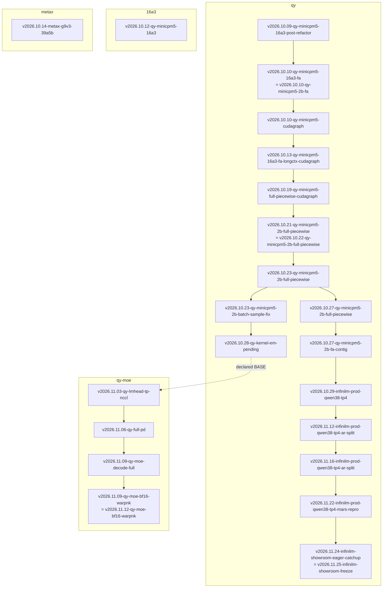
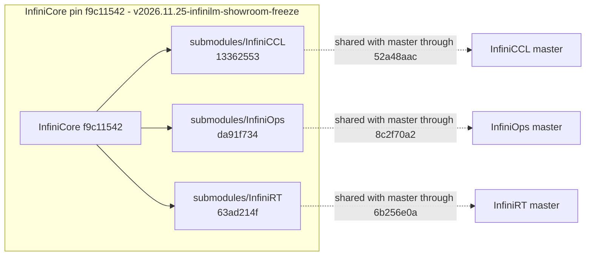
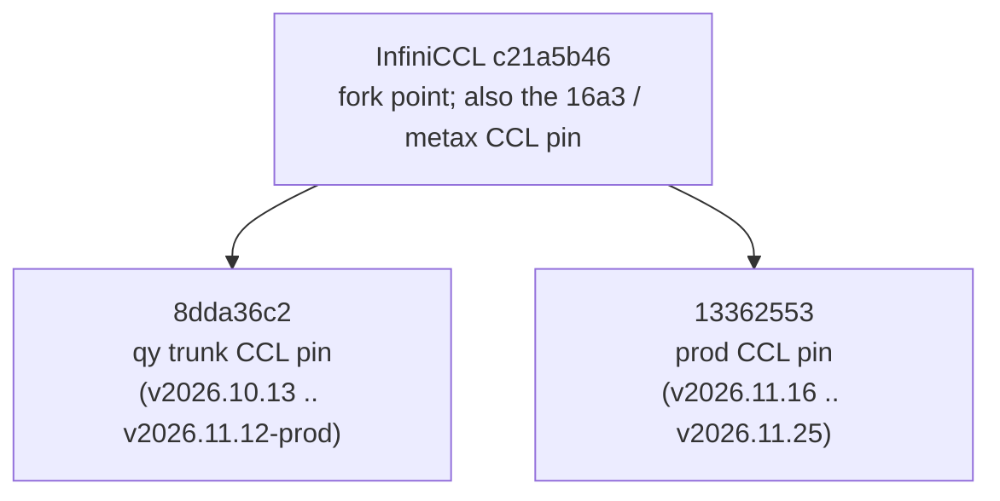
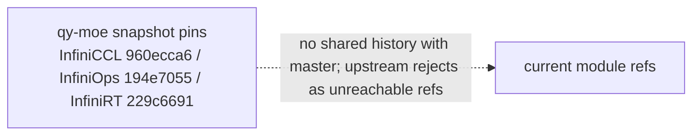

# Tag lineage graphs

Renderable on GitHub (native mermaid). The first graph is generated; do not
hand-edit it:

    scripts/lineage.sh graph --mermaid

(needs `IC_DIR` / `IL_DIR` mirrors, see docs/lineage.md). A static SVG can be
produced from the same source with mermaid-cli if one is ever required.

## Top-level pin lineage

Product order over InfiniCore x InfiniLM, Oct-Nov scope: 22 pins across four
streams. Dashed edge = declared `BASE` (orphan snapshot seed), which ancestry
cannot derive. Node label suffix `= ...` marks a republished tag (identical pin
vector).

Note: `v2026.10.28-qy-kernel-em-pending` is an InfiniLM ancestor of
`v2026.11.24` but not an InfiniCore ancestor, so it is not in that tag's
lineage - the product order, not either leaf alone.

## Nested dependency leaves of the refreeze pin

InfiniOps and InfiniRT share with their masters only through their
v2026.10.09-era pins - the same picture as InfiniCore itself.

## InfiniCCL divergence

`13362553` does not contain `8dda36c2`. A nested-aware product order would
break the published parent chain between `v2026.11.12-prod` and
`v2026.11.16` - recorded but not yet applied (docs/lineage.md section 3.6).

## qy-moe orphan pins

